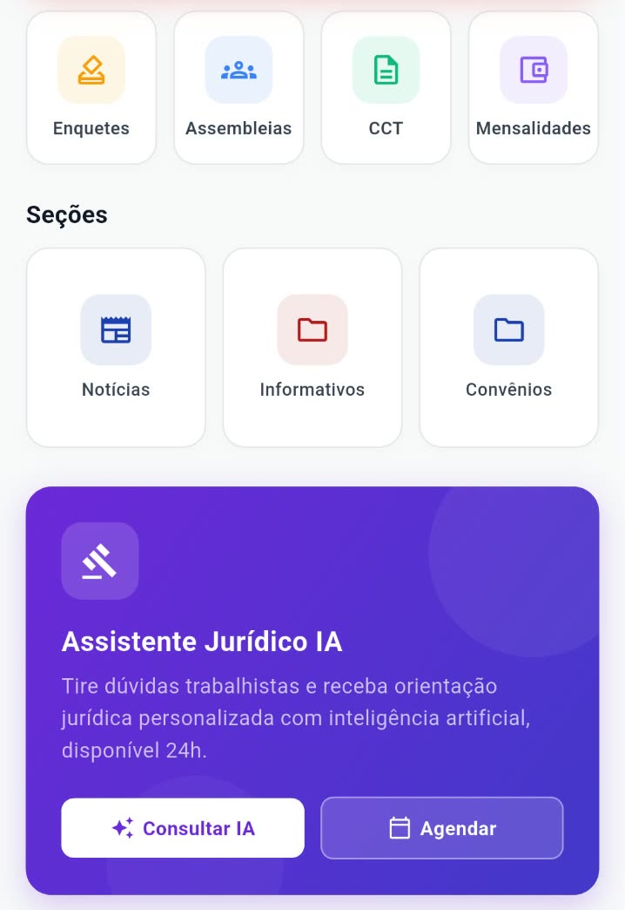
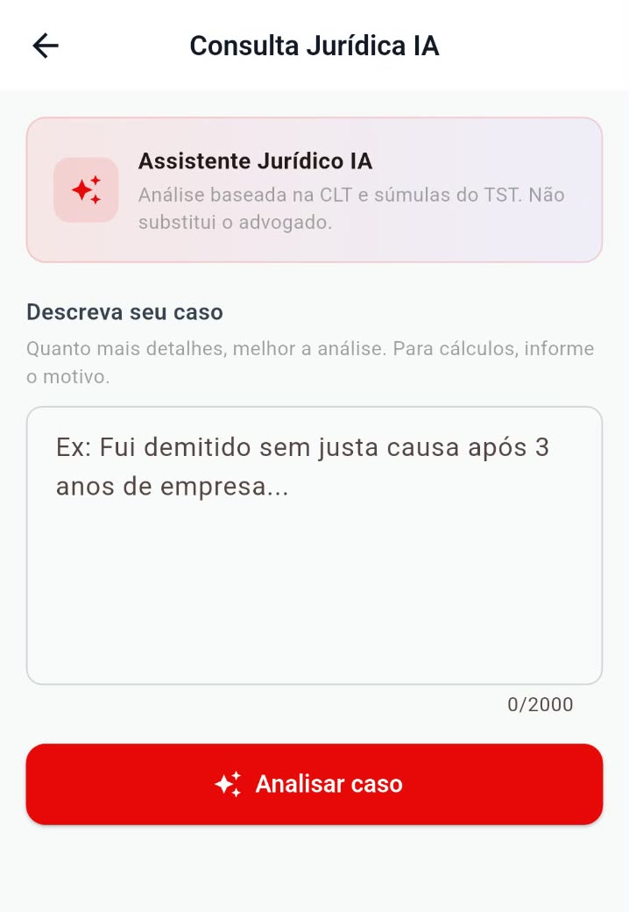
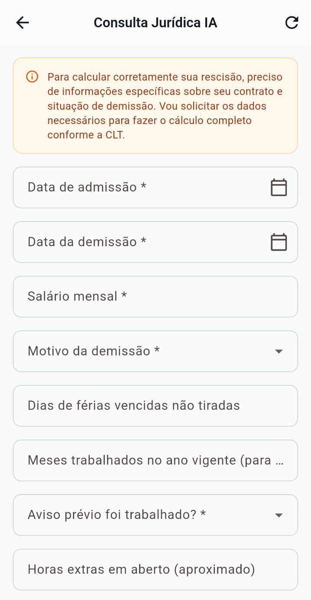
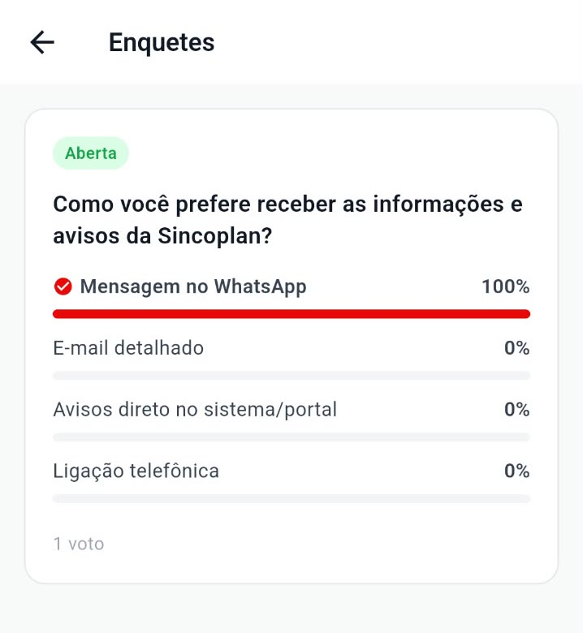
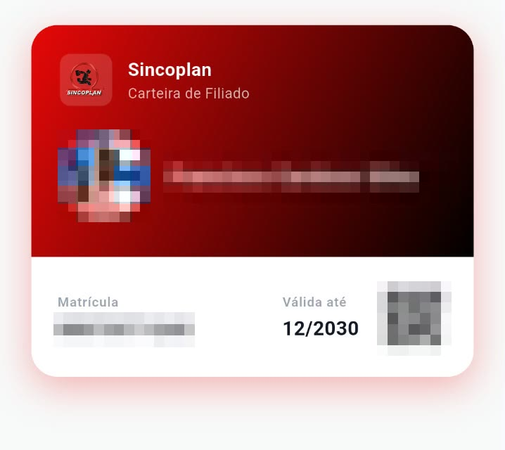
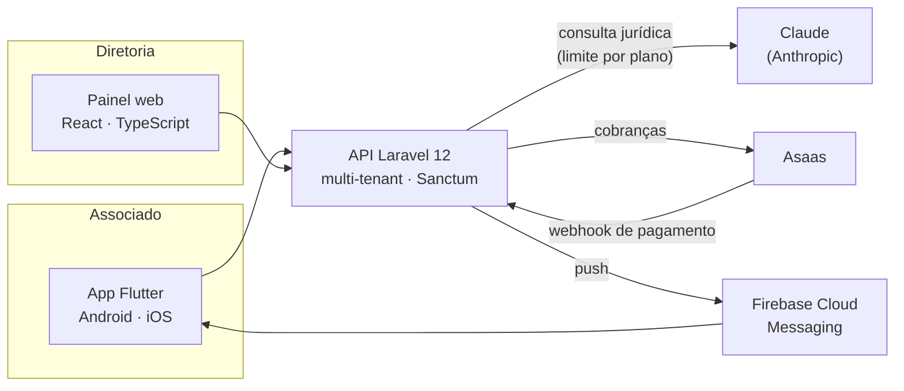

# AppSindical: o sindicato no bolso do associado, com assistente jurídico de IA

> **Cliente:** Sindibank
> **Entrega:** [AtosSofts](https://atossofts.com.br)
> **Código:** privado (propriedade do cliente). Este repositório mostra só a arquitetura e as funcionalidades.

  
  
  
  

  

Telas do app em uso por um dos sindicatos atendidos (Sincoplan). Dados pessoais do associado ocultados.

---

## O problema

O sindicato precisa falar com milhares de associados, mas tudo depende de grupo de WhatsApp, papel e atendimento presencial: carteirinha impressa, assembleia sem quórum, mensalidade cobrada à mão e dúvida trabalhista que **só o advogado responde, e só em horário comercial.**

## A solução

Uma plataforma **SaaS multi-sindicato**, em que cada sindicato tem o seu espaço, com **painel web** para a diretoria e **app Android/iOS** para os associados.

### ⚖️ Assistente Jurídico com IA
O associado pergunta, por exemplo, *"fui demitido sem justa causa, quais são meus direitos?"*, e recebe uma orientação baseada na CLT e nas súmulas do TST, em linguagem simples, a qualquer hora. Quando o caso pede um cálculo, como o de uma rescisão, **a própria IA identifica os dados que faltam e monta um formulário** para o associado preencher. Funciona com o **Claude (Anthropic)**, com:
- **limite mensal de consultas por plano**, para manter o custo previsível para o sindicato;
- histórico de consultas do associado;
- relatório de uso para a diretoria;
- aviso claro de que é **orientação informativa e não substitui o advogado**. Quando o caso exige, o associado **agenda o atendimento jurídico** pelo próprio app.

### 📱 Para o associado (app)
Carteirinha digital com QR Code · notícias e comunicados · notificações push · assembleias · enquetes e votações · eventos · convenções coletivas (CCT) · agendamento jurídico · mensalidades

### 🖥️ Para a diretoria (painel web)
Gestão de associados · publicações e seções do app · assembleias, enquetes e eventos · cobrança de mensalidades integrada ao **Asaas** (com webhook de pagamento) · notificações push para todos ou para associados específicos · captação de novos associados · personalização por sindicato

---

## Arquitetura

## Stack

`Flutter` `Riverpod` `go_router` `Firebase Messaging` · `React` `TypeScript` `Vite` `Tailwind` · `Laravel 12` `Sanctum` `PHP` · `Claude (Anthropic)` · `Asaas`

## Resultados

<!-- {{preencher com números reais autorizados pelo cliente, ex.: associados ativos, consultas à IA por mês, % de mensalidades pagas pelo app}} -->
*Em breve.*

---

**Seu sindicato, associação ou escritório quer um app assim?** → [atossofts.com.br](https://atossofts.com.br) · [LinkedIn](https://www.linkedin.com/in/dimmisueg/)

🇺🇸 Multi-tenant SaaS for Brazilian labor unions: Flutter app + React admin + Laravel API, digital member card, assemblies, polls, dues billing (Asaas) and a Claude-powered legal assistant with per-plan usage limits. Client code is private.
